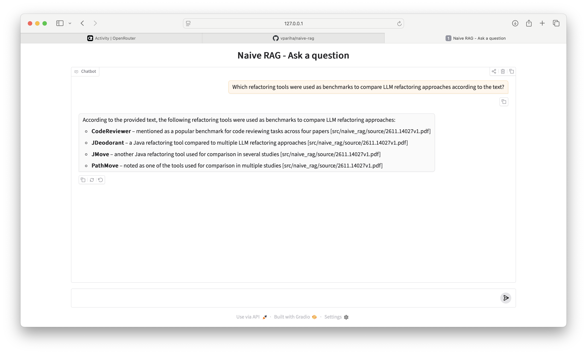

# Naive RAG

Naive RAG is a Python-based retrieval-augmented generation application for asking questions about PDF documents. It extracts PDF content with Docling, splits it into Markdown chunks, stores embeddings in ChromaDB, retrieves relevant chunks, and generates grounded answers in a Gradio chat interface.



## Features

- PDF document ingestion with Docling
- Markdown chunking with deterministic document and chunk IDs
- Persistent cosine-similarity vector storage with ChromaDB
- Hugging Face embeddings
- Streaming answers from OpenRouter, OpenAI, Ollama, or another LangChain chat provider
- A citation-aware chat prompt
- Retrieval evaluation utilities for similarity search and MMR

## Tech Stack

- Python 3.14
- LangChain
- ChromaDB
- Hugging Face Sentence Transformers
- Docling
- Gradio
- `uv`

## Project Structure

```text
src/naive_rag/
├── config/
│   └── setting.py          # Environment-backed application settings
├── ingestion/
│   └── ingestion_service.py
├── persistance/
│   └── vector_store.py     # Persistent ChromaDB vector store
├── model/
│   └── model.py            # Embedding and chat model factories
├── retrival/
│   └── retriver_service.py # Retrieval chain and answer prompt
├── evalutation/
│   ├── generate_eval_questions.py
│   └── retrieval_evaluation.py
├── source/
│   └── 2611.14027v1.pdf     # Example source document
└── main.py                 # Gradio application entry point
```

## Prerequisites

- Python 3.14
- [`uv`](https://docs.astral.sh/uv/)
- An API key if the selected chat provider requires one
- Enough disk space for embeddings and the persistent ChromaDB database

## Installation

Clone the repository and install the locked dependencies:

```bash
git clone https://github.com/vpariha/naive-rag.git
cd naive-rag
uv sync
```

## Configuration

Create a `.env` file in the repository root. The application loads environment variables with `python-dotenv`.

```dotenv
# Vector database
CHROMA_PERSIST_DIRECTORY=./chroma_db
CHROMA_COLLECTION_NAME=my_collection

# Retrieval
TOP_K=5
CHUNK_SIZE = 500
CHUNK_OVERLAP = 100

# Embeddings
EMBEDDING_MODEL_PROVIDER=huggingface
EMBEDDING_MODEL_NAME=sentence-transformers/all-MiniLM-L6-v2

# Chat model
CHAT_MODEL_PROVIDER=openrouter
CHAT_MODEL_NAME=openrouter/free
CHAT_MODEL_TEMPERATURE=0.5

# Add the key required by your selected provider
OPENROUTER_API_KEY=your_api_key
```

Other provider-specific environment variables, such as `OPENAI_API_KEY`, can be added when changing `CHAT_MODEL_PROVIDER`.

> Never commit `.env` or API keys. The repository ignores `.env`.

### Supported Configuration Fields

| Variable                   | Purpose                                      | Example                                  |
| -------------------------- | -------------------------------------------- | ---------------------------------------- |
| `CHROMA_PERSIST_DIRECTORY` | Directory used for persistent vector storage | `./chroma_db`                            |
| `CHROMA_COLLECTION_NAME`   | ChromaDB collection name                     | `my_collection`                          |
| `TOP_K`                    | Number of chunks retrieved per question      | `5`                                      |
| `EMBEDDING_MODEL_PROVIDER` | LangChain embeddings provider                | `huggingface`                            |
| `EMBEDDING_MODEL_NAME`     | Embedding model identifier                   | `sentence-transformers/all-MiniLM-L6-v2` |
| `CHAT_MODEL_PROVIDER`      | LangChain chat provider                      | `openrouter`                             |
| `CHAT_MODEL_NAME`          | Chat model identifier                        | `openrouter/free`                        |
| `CHAT_MODEL_TEMPERATURE`   | Chat model sampling temperature              | `0.5`                                    |

## Ingest Documents

Place PDF files in `src/naive_rag/source/`, then run the project module. Ingestion is currently disabled in `main()`; invoke `IngestionService.ingest_data_using_dolcing()` explicitly for a first-time setup:

```bash
uv run python -c "from naive_rag.ingestion.ingestion_service import IngestionService; IngestionService().ingest_data_using_dolcing('src/naive_rag/source')"
```

The ingestion process:

1. Discovers all PDF files below the source directory.
2. Converts each PDF to Markdown with Docling.
3. Generates stable document and chunk hashes.
4. Stores chunks in batches of 10 in ChromaDB.

Re-running ingestion reuses the same deterministic chunk IDs.

## Run the Application

Start the Gradio chat interface:

```bash
uv run python -m naive_rag.main
```

Open the local URL printed by Gradio, place a question in the chat input, and receive a streamed response based on the retrieved document context.

## Retrieval Evaluation

The evaluation utilities can generate a labeled question dataset and compare similarity search with maximum marginal relevance (MMR).

Generate evaluation questions from ingested chunks by calling `generate_eval_question(context, question_count)` from `generate_eval_questions.py`. Results are appended to `evaluation.json`.

Run retrieval metrics:

```bash
uv run python -m naive_rag.evalutation.retrieval_evaluation
```

The evaluation reports:

- Recall@K
- Precision@K
- Mean Reciprocal Rank
- NDCG@K

Both retrieval strategies are evaluated with `K=5` by default.

## How It Works

```text
PDFs
  -> Docling Markdown conversion
  -> Markdown chunk splitting
  -> Hugging Face embeddings
  -> Persistent ChromaDB collection
  -> Top-K similarity retrieval
  -> Prompt with retrieved context
  -> Streaming chat model response
```

Answers are intended to be grounded only in retrieved document context and include the source metadata available with each chunk.
